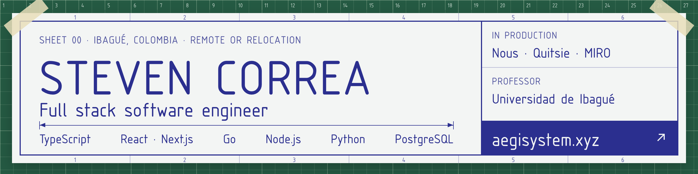

I build complete products, from the database to the interface, as the sole developer, and I put them in production. I verify them with tests, written decisions (ADRs) and measured performance. I also teach software engineering at Universidad de Ibagué.

**Open to remote roles or relocation** · English C1 · native Spanish

[Portfolio](https://aegisystem.xyz/?lang=en) · [LinkedIn](https://www.linkedin.com/in/Stev-Corr) · [CV (PDF, Spanish)](https://aegisystem.xyz/assets/cv/CV_Steven_Correa_ES.pdf)

## In production

| | What it is | Stack | Proof |
|---|---|---|---|
| **[Nous](https://nous.aegisystem.xyz)** | Supervised exam platform for computer labs: real-time proctoring, 8 question types with auto-grading and partial credit, built-in spreadsheet and diagram tools. Used by other professors. | TypeScript, Next.js, PostgreSQL, WebSockets | 500+ commits in 7 weeks. Saving an exam's grades went from **5.8 s to 0.86 s** (26 DB round trips to 5). |
| **[Quitsie](https://quitsie.aegisystem.xyz)** · [code](https://github.com/Aegisystem/Quitsie) | Offline-first PWA for shared expenses, with live updates (SSE) and Web Push notifications. | React, TypeScript, Go, PostgreSQL, Docker, Railway | 13 ADRs, Go tests with one database per test, Playwright e2e, 14 security findings closed. |
| **[MIRO](https://miro.unibague.edu.co)** | Reporting platform that replaced spreadsheets at Universidad de Ibagué. | Node.js, Express, MongoDB, React, Next.js | Live at the university. Built from 2024 to 2025. |

## Also built

- **[Exógena DIAN](https://github.com/Aegisystem/Report-To-ExogenaDian)**: turns Colombian e-invoicing exports into the 8 DIAN exógena tax formats. Python, Flask, PostgreSQL, pandas. Part of my DIAN automation work, which took tax reports from one hour by hand to five minutes.
- **[Advanced algorithms course](https://algo.aegisystem.xyz)** · [code](https://github.com/Aegisystem/AlgorithmsAndDataStructuresCourse): a 16-week competitive programming course in Python that I'm writing, with problems from CSES, AtCoder and Codeforces. In progress.
- **[Mesa 21](https://bj.aegisystem.xyz)** · [code](https://github.com/Aegisystem/BlackJack-Simulator): blackjack basic-strategy trainer. Static site, no dependencies.

## How I work

- **Verify before "done":** test suites, verification scripts and end-to-end tests.
- **Write decisions down:** ADRs for architecture choices, security reviews before release.
- **Measure:** performance claims come with numbers.
- **AI-assisted, human-verified:** I work with Claude Code, and every change is backed by tests and reviews.

## Stack

- **Languages:** TypeScript, JavaScript, Go, Python, Java
- **Frontend:** React, Next.js, Vite, PWA (IndexedDB, service workers)
- **Backend:** Node.js, Express, NestJS, Go, Flask
- **Data:** PostgreSQL, MongoDB, SQLite
- **Delivery:** Docker, GitHub Actions, Railway, Netlify, Playwright

## Background

- Software Engineering professor, Universidad de Ibagué (2025 to present)
- MSc in Software Engineering, Universidad de los Andes (in progress)
- Systems Engineering, Universidad de Ibagué (2020 to 2025)
- Supply chain intern at SLB: automation with Python and Power Platform (2024 to 2025)
- Scrum Master (2025) · HackerRank: Problem Solving (Intermediate), JavaScript, Java

<b>En español</b>

 

Construyo productos completos, de la base de datos a la interfaz, como único desarrollador, y los llevo a producción. Los verifico con pruebas, decisiones escritas (ADR) y rendimiento medido. También enseño ingeniería de software en la Universidad de Ibagué.

**Disponible para trabajo remoto o reubicación.** Inglés C1.

- **Nous:** plataforma de exámenes supervisados para salas de cómputo. Guardar las notas de un examen pasó de 5,8 s a 0,86 s.
- **Quitsie:** PWA para gastos compartidos que funciona sin conexión. React, Go y PostgreSQL.
- **MIRO:** plataforma de informes que reemplazó las hojas de cálculo en la Universidad de Ibagué.

[Portafolio en español](https://aegisystem.xyz/?lang=es) · [CV (PDF)](https://aegisystem.xyz/assets/cv/CV_Steven_Correa_ES.pdf)

